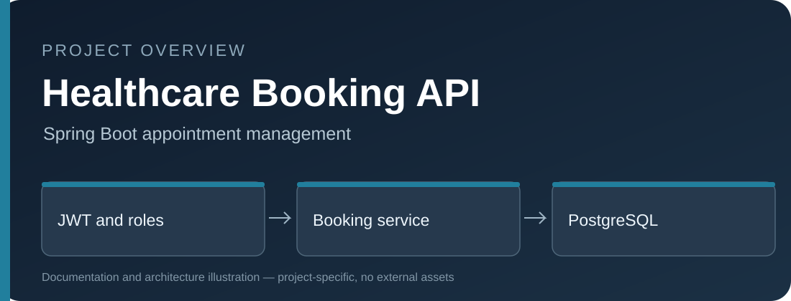

# HealthConnect — Healthcare Appointment Booking API



A Spring Boot REST API for healthcare appointments with JWT authentication, role-based access, doctor scheduling, and patient booking.

## Stack
Java 17, Spring Boot 3.3, Spring Security, Spring Data JPA, PostgreSQL, Lombok, JUnit 5 and Mockito.

## Features
- Register and authenticate patients and doctors.
- Issue JWT bearer tokens and enforce role permissions.
- Manage recurring doctor availability in 30-minute slots.
- Prevent duplicate reservations and enforce patient age requirements.
- Allow assigned doctors to confirm or reject appointments.
- Restrict cancellation to authorized users.
- Run automated tests with GitHub Actions.

## Environment configuration
Provide `DB_URL`, `DB_USERNAME`, `DB_PASSWORD` and a strong random `JWT_SECRET`. Do not commit secrets to Git.

```bash
export DB_URL=jdbc:postgresql://localhost:5432/healthconnect
export DB_USERNAME=postgres
export DB_PASSWORD=your-local-password
export JWT_SECRET=replace-with-a-long-random-secret-at-least-32-bytes
bash ./mvnw verify
bash ./mvnw spring-boot:run
```

Windows: use `mvnw.cmd` and configure environment variables in your shell.

## API overview
| Method | Endpoint | Purpose |
| --- | --- | --- |
| POST | `/api/auth/register` | Register patient or doctor |
| POST | `/api/auth/login` | Get JWT token |
| GET | `/api/doctors` | List doctors |
| POST | `/api/availability` | Set doctor hours |
| GET | `/api/availability/{doctorId}/slots?date=YYYY-MM-DD` | Available slots |
| POST | `/api/appointments` | Book appointment |
| PATCH | `/api/appointments/{id}/confirm` | Confirm |
| PATCH | `/api/appointments/{id}/reject` | Reject |
| PATCH | `/api/appointments/{id}/cancel` | Cancel |

## Security note
Previously committed credentials must be rotated; updating the current configuration does not erase historical Git commits. This is a demonstration project, not a system for real patient data.
